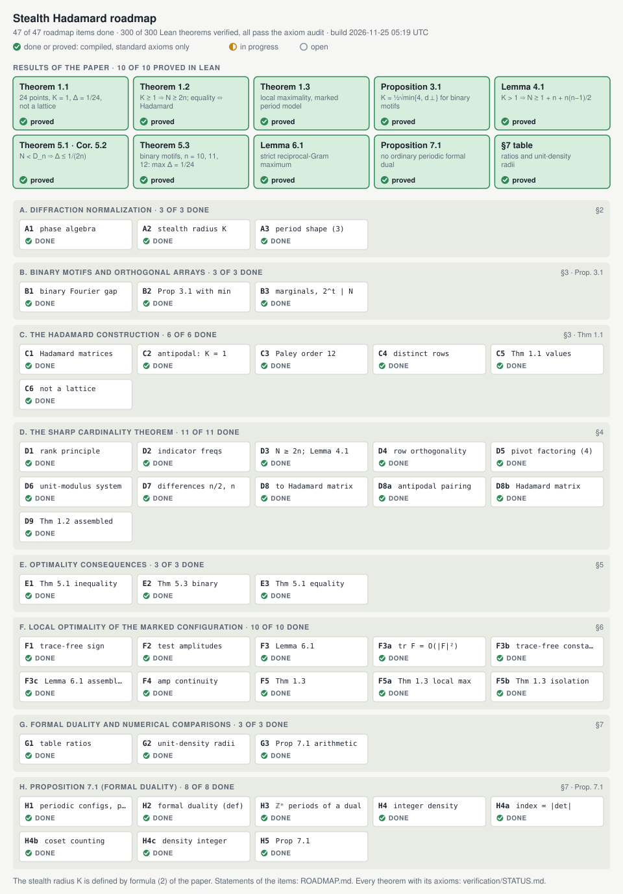

# stealth-non-lattice

J. Park, *Hadamard configurations and sharp cubic-period bounds for stealth in dimensions 10, 11, and 12*
(4 Nov 2026): [`view.pdf`](view.pdf).

## Lean verification roadmap

The picture is redrawn by CI after every verified build of `main`. Click it for the statements of the items
([`stealth-lean/ROADMAP.md`](stealth-lean/ROADMAP.md)).

[`stealth-lean/`](stealth-lean/) is a Lean 4 + Mathlib project that formalizes results of the paper. Proved
there, with only Lean's standard axioms: Theorem 1.1 (including that the configurations are not translates of
lattices), the bound `N ≥ 2n` of Theorem 1.2 and its converse, Lemma 4.1, Proposition 3.1 in gap form, the
inequalities of Theorem 5.1 and Corollary 5.2, and Theorem 5.3. Not proved: the equality case of Theorem 1.2,
Theorem 1.3, Lemma 6.1 and Proposition 7.1.

- [What is and is not verified](stealth-lean/README.md)
- [Roadmap: the ordered work list, with the statement of every item](stealth-lean/ROADMAP.md)
- [Verification status: every theorem with its axioms](stealth-lean/verification/STATUS.md) (rewritten by CI;
  [workflow runs](https://github.com/JosiahPark/stealth-non-lattice/actions/workflows/lean.yml))
- Interactive version of the map: [`stealth-lean/docs/roadmap.html`](stealth-lean/docs/roadmap.html). Download it and
  open it in a browser; once GitHub Pages is enabled for this repository it is also served at
  https://josiahpark.github.io/stealth-non-lattice/stealth-lean/docs/roadmap.html.
